<h1 align="center">
  <picture>
    <source media="(prefers-color-scheme: dark)" srcset="assets/banner-dark.svg">
    
  </picture>
</h1>

  Code examples, framework integrations, and tools for testing with <a href="https://digital.ai/products/continuous-testing/"><strong>Digital.ai Testing</strong></a>. 
  Find what fits your workflow and build from there.

  
  
  
  

 

## What do you want to do?

<table width="100%">
  <tr>
    <td valign="top" width="33%">
      <h3>Solve a testing problem</h3>
      Find examples built around a specific testing scenario.
        
      <a href="#use-cases"><strong>Explore use cases →</strong></a>
    </td>
    <td valign="top" width="33%">
      <h3>Connect your framework</h3>
      Explore how your framework works with Digital.ai Testing.
        
      <a href="#integrations"><strong>Explore integrations →</strong></a>
    </td>
    <td valign="top" width="33%">
      <h3>Add a testing tool</h3>
      Find utilities built by Digital.ai for your testing workflows.
        
      <a href="#tools"><strong>Explore tools →</strong></a>
    </td>
  </tr>
</table>

## Explore the catalog

Browse by purpose, then check the technology details to find the right starting point.

<strong>Platform key:</strong>&nbsp; 📱 Mobile &nbsp;·&nbsp; 🌐 Web

### Use cases

<table width="100%">
  <thead>
    <tr>
      <th align="left" width="26%">Project</th>
      <th align="left" width="44%">What it helps you do</th>
      <th align="left" width="22%">Technology</th>
      <th align="center" width="8%">Platform</th>
    </tr>
  </thead>
  <tbody>
    <tr>
      <td valign="top">
        <a href="https://github.com/ExperitestOfficial/ct-robot-framework-daimobile"><strong>Reporter Customization with Robot Framework</strong></a>
      </td>
      <td valign="top">Customize Digital.ai test reports with Robot Framework and Python: improve reporting accuracy, tailor video reports, and add properties for filtering results.</td>
      <td valign="top">
        
        
      </td>
      <td valign="top" align="center">📱</td>
    </tr>
    <tr>
      <td valign="top">
        <a href="https://github.com/ExperitestOfficial/CT-Self-Healing-Tests"><strong>AI-Powered Self-Healing Tests</strong></a>
      </td>
      <td valign="top">Compare test behavior with and without AI-powered self-healing, with a step-by-step guide to getting started.</td>
      <td valign="top">
        
        
        
      </td>
      <td valign="top" align="center">📱</td>
    </tr>
  </tbody>
</table>

### Integrations

<table width="100%">
  <thead>
    <tr>
      <th align="left" width="26%">Project</th>
      <th align="left" width="44%">What it helps you do</th>
      <th align="left" width="22%">Technology</th>
      <th align="center" width="8%">Platform</th>
    </tr>
  </thead>
  <tbody>
    <tr>
      <td valign="top">
        <a href="https://github.com/ExperitestOfficial/ct-specflow-nunit-bdd-bp"><strong>BDD with SpecFlow and NUnit</strong></a>
      </td>
      <td valign="top">Set up a .NET test automation project using SpecFlow for behavior-driven development and NUnit to execute tests.</td>
      <td valign="top">
        
        
        
      </td>
      <td valign="top" align="center">📱</td>
    </tr>
    <tr>
      <td valign="top">
        <a href="https://github.com/ExperitestOfficial/CT-Jenkins-Example-With-Pipeline-Scripting"><strong>Jenkins Pipeline with Groovy</strong></a>
      </td>
      <td valign="top">Use a Jenkins Pipeline and Groovy scripting to call Digital.ai Continuous Testing APIs and retrieve automated test execution results.</td>
      <td valign="top">
        
        
      </td>
      <td valign="top" align="center">📱</td>
    </tr>
    <tr>
      <td valign="top">
        <a href="https://github.com/ExperitestOfficial/CT-Axe-Integration-Cross-Browser"><strong>Web Accessibility with Deque axe</strong></a>
      </td>
      <td valign="top">Scan web pages with Deque axe libraries, identify accessibility violations, and include the findings in Digital.ai Continuous Testing reports.</td>
      <td valign="top">
        
        
        
      </td>
      <td valign="top" align="center">🌐</td>
    </tr>
  </tbody>
</table>

### Tools

<table width="100%">
  <thead>
    <tr>
      <th align="left" width="26%">Project</th>
      <th align="left" width="44%">What it helps you do</th>
      <th align="left" width="22%">Technology</th>
      <th align="center" width="8%">Platform</th>
    </tr>
  </thead>
  <tbody>
    <tr>
      <td valign="top">
        <a href="https://github.com/digitalai-opensource/digital-ai-testing-mcp"><strong>digital-ai-testing-mcp</strong></a>
      </td>
      <td valign="top">Connect compatible AI assistants to your Digital.ai Testing device farm. Ask questions and perform supported actions in plain language.</td>
      <td valign="top">
        
      </td>
      <td valign="top" align="center">📱&nbsp;🌐</td>
    </tr>
    <tr>
      <td valign="top">
        <a href="https://github.com/raheekhandigitalai/Digital.ai-Testing-Test-Orchestrator"><strong>Test Orchestrator</strong></a>
      </td>
      <td valign="top">Define test execution behavior through configuration alongside your existing tests.</td>
      <td valign="top">
        
        
        
      </td>
      <td valign="top" align="center">📱</td>
    </tr>
  </tbody>
</table>

<strong>How the collection is organized</strong>

 

| Prefix | What belongs here | Examples |
| :--- | :--- | :--- |
| `UseCase-` | An example demonstrating a specific testing scenario. | Reporting customization; self-healing tests |
| `Integration-` | Examples connecting a framework or external system to Digital.ai Testing. | SpecFlow and NUnit; Jenkins; Deque axe |
| `Tool-` | A product utility that supports testing work. | Test Orchestrator |

Languages, frameworks, and platforms are separate attributes. A Java example can belong to any of these categories. Category describes the project’s main purpose.

## Using the code

<table width="100%">
  <tr>
    <td valign="top" width="33%">
      <h3>1️⃣ Choose a project</h3>
      Find a relevant use case, integration, or tool.
    </td>
    <td valign="top" width="33%">
      <h3>2️⃣ Check its requirements</h3>
      Read the repository’s setup instructions and supported versions.
    </td>
    <td valign="top" width="33%">
      <h3>3️⃣ Try it in your environment</h3>
      Configure the required connections and follow the example.
    </td>
  </tr>
</table>

> [!TIP]
> Each repository’s README is the starting point for setup, expected results, and troubleshooting. Check it for the project’s license, maintenance status, and support information.

 

  Have questions or need help? Reach out to our <a href="https://support.digital.ai/"><strong>Support Team</strong></a>.

